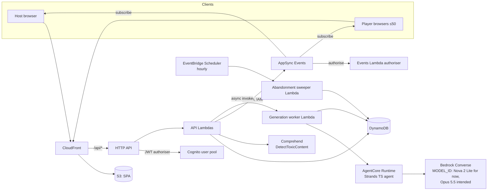
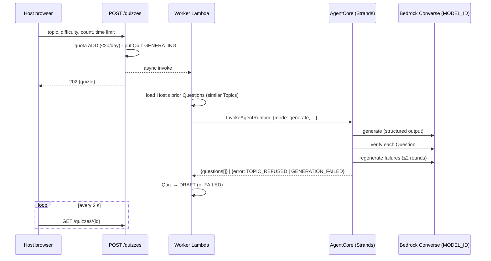
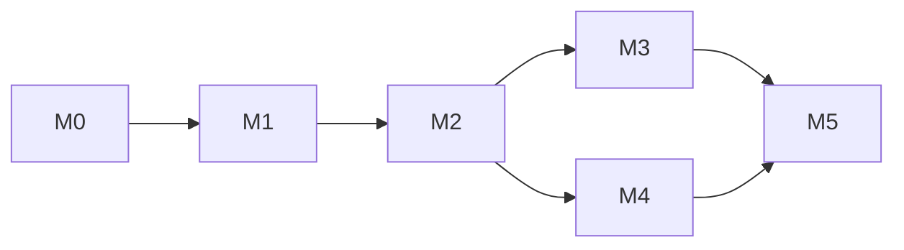

# Quiz App: Implementation Plan

- **Status:** Draft v1
- **Date:** 2026-10-25
- **Inputs:** [`PRD.md`](./PRD.md) (requirements, numbered `FR-x.y`), [`GLOSSARY.md`](../GLOSSARY.md) (terms), [`adr/`](./adr/) (decisions)

This plan turns the PRD into an architecture, a data model, interface contracts and an ordered set of milestones. Each milestone ends in something deployable to **dev** that can be demonstrated. Defaults this plan picks without having discussed them are collected in §11; change any you disagree with before M0 starts.

---

## 1. Approach

1. **Domain logic first, in a pure package.** All the Game rules live in one TypeScript package with no AWS dependencies, so they can be unit-tested exhaustively. That covers the phases, scoring, ranking, Nickname normalisation and Join Codes. The Lambdas are thin adapters around it.
2. **The live-play core before AI.** Milestone 2 plays complete Games from a hand-seeded Ready Quiz, which de-risks real-time play, timing and auth without spending money on the model. Generation arrives in M3.
3. **Spike the unknowns early.** M0 proves the three riskiest integrations end to end before anything depends on them:
   - CloudFormation support for AgentCore and AppSync Events;
   - a Strands TypeScript agent on AgentCore calling the `au.` inference profile;
   - an AppSync Events Lambda authoriser.
4. **Code speaks the glossary.** Types, tables, events and routes use the glossary terms exactly: `Quiz`, `Question`, `Option`, `Game`, `Player`, `Answer`, `Score`, `Leaderboard`, `JoinCode`, `Nickname`, and the phases `LOBBY`, `QUESTION_OPEN`, `REVEAL`, `FINISHED`.

---

## 2. Architecture



**Rules that hold everywhere**

- Clients never publish to AppSync Events. Every change goes through the HTTP API, then DynamoDB, then a publish (ADR 0002).
- Pushed events are **notifications**. The source of truth is always the snapshot endpoint, which clients re-fetch on load, on reconnect, or when they detect a version gap.
- Server time is the only clock (ADR 0003). Events carry `serverNow`, so clients can correct their countdown display for clock skew. That correction is for display only.
- The correct Option is **never** sent to Players before Reveal.

---

## 3. Repository layout

The monorepo uses pnpm workspaces and TypeScript project references.

```
/
├── GLOSSARY.md
├── docs/                      PRD, PLAN, ADRs
├── packages/
│   ├── domain/                pure TS: Game state machine, scoring, ranking,
│   │                          Nickname rules, Join Code, Quiz lifecycle. No AWS SDK.
│   ├── contracts/             shared zod schemas + types: HTTP request/response
│   │                          bodies, event payloads, agent input/output
│   ├── api/                   Lambda handlers (HTTP routes, Events authoriser,
│   │                          generation worker, sweeper) + DynamoDB repository
│   ├── agent/                 Strands agent (generate / verify / regenerate),
│   │                          Dockerfile for AgentCore Runtime
│   └── web/                   React SPA (Vite): /host/*, /play/*
├── infra/
│   ├── foundation.yaml        CloudFormation
│   ├── agent.yaml             CloudFormation
│   ├── api.yaml               CloudFormation + SAM transform
│   ├── web.yaml               CloudFormation
│   └── params/{dev,prod}.json
├── scripts/                   seed-quiz (dev only), smoke test, agent eval
└── .github/workflows/         ci.yml, deploy.yml
```

---

## 4. Data model (DynamoDB, single table)

The table is `quizapp-{env}`, with a string partition key `PK`, a string sort key `SK`, and one sparse index, `GSI1`.

| Entity                | PK                    | SK                                     | Key attributes                                                                                                                                                    | Notes                                                                                                                  |
| --------------------- | --------------------- | -------------------------------------- | ----------------------------------------------------------------------------------------------------------------------------------------------------------------- | ---------------------------------------------------------------------------------------------------------------------- |
| **Quiz**              | `HOST#{hostId}`       | `QUIZ#{quizId}`                        | `status` (`GENERATING`, `DRAFT`, `READY`, `FAILED`), `topic`, `difficulty`, `defaultTimeLimit`, `questions[]`, `failureReason`, `version`                         | Questions are embedded: 20 or fewer, well under the 400 KB item limit. `READY` items are never updated again (FR-3.3). |
| Question (embedded)   | –                     | –                                      | `questionId`, `text`, `options[{optionId, text}]`, `correctOptionId`, `timeLimit?`, `status` (`OK`, `REGENERATING`)                                               | `timeLimit` is absent when the Quiz default applies.                                                                   |
| **Game**              | `GAME#{gameId}`       | `META`                                 | `hostId`, `quizSnapshot`, `phase`, `questionIndex`, `questionOpenedAt`, `deadline`, `answeredCount`, `activePlayerCount`, `joinCode`, `lastActivityAt`, `version` | `quizSnapshot` is copied from the Ready Quiz at Game start, so deleting the Quiz never affects the Game (FR-3.4).      |
| Unfinished Game index | `GSI1PK = UNFINISHED` | `GSI1SK = {lastActivityAt}`            | –                                                                                                                                                                 | Sparse index, removed when the Game is Finished. The sweeper uses it (FR-8.4).                                         |
| **Player**            | `GAME#{gameId}`       | `PLAYER#{playerId}`                    | `nickname`, `score`, `removed`, `joinedAt`                                                                                                                        |                                                                                                                        |
| Nickname claim        | `GAME#{gameId}`       | `NICK#{normalisedNickname}`            | `playerId`                                                                                                                                                        | Conditional put, so uniqueness holds even under concurrent joins (FR-5.2).                                             |
| **Answer**            | `GAME#{gameId}`       | `ANSWER#{questionIndex:02}#{playerId}` | `optionId`, `receivedAt`, `points`                                                                                                                                | `attribute_not_exists` makes each Answer write-once (FR-6.4).                                                          |
| Join Code claim       | `JOINCODE#{code}`     | `META`                                 | `gameId`                                                                                                                                                          | Conditional put, deleted when the Game is Finished (FR-4.3).                                                           |
| Active Game claim     | `HOST#{hostId}`       | `ACTIVE_GAME`                          | `gameId`                                                                                                                                                          | Conditional put enforces one unfinished Game per Host (FR-4.2).                                                        |
| **History**           | `HOST#{hostId}`       | `HISTORY#{finishedAt}#{gameId}`        | `quizSnapshot`, `leaderboard[]`, `optionCounts[][]`, `abandoned`                                                                                                  | Written in the same transaction that finishes the Game (FR-9.1).                                                       |
| Generation quota      | `HOST#{hostId}`       | `QUOTA#{yyyy-mm-dd}`                   | `count`, `ttl`                                                                                                                                                    | Atomic `ADD count 1` with the condition `count < 20` (FR-2.7).                                                         |

**Concurrency rules**

- Every Game phase transition is a conditional update on `version`, plus the expected `phase` and `questionIndex`. When two requests race, for example a Host close against the last Answer's auto-close, exactly one succeeds and the other is a no-op.
- Submitting an Answer is a single `TransactWriteItems` that does four things:
  - puts the Answer (write-once);
  - adds the Answer's points to the Player's `score`;
  - adds 1 to the Game's `answeredCount`, with the condition that the Game is still in `QUESTION_OPEN` at the same index and the deadline hasn't passed;
  - checks that the Player hasn't been removed.

  If `answeredCount` then equals `activePlayerCount`, the handler attempts the close transition (FR-6.6).

---

## 5. HTTP API

All routes sit under `/api`, served through CloudFront. Request and response bodies are zod schemas in `packages/contracts`.

### Host routes (Cognito JWT authoriser)

| Method and path                                            | Purpose                                                                                                                | FR            |
| ---------------------------------------------------------- | ---------------------------------------------------------------------------------------------------------------------- | ------------- |
| `POST /quizzes`                                            | Start generating `{topic, difficulty, questionCount, defaultTimeLimit}` and return `{quizId}` with status `GENERATING` | 2.1, 2.2, 2.7 |
| `GET /quizzes`                                             | List the Host's Quizzes                                                                                                | H6            |
| `GET /quizzes/{quizId}`                                    | Return a Quiz with its Questions. Polled while generating.                                                             | 2.2, 3.2      |
| `DELETE /quizzes/{quizId}`                                 | Delete a Draft or Ready Quiz                                                                                           | 3.2, 3.4      |
| `DELETE /quizzes/{quizId}/questions/{questionId}`          | Discard a Question (Drafts only)                                                                                       | 3.2           |
| `POST /quizzes/{quizId}/questions/{questionId}/regenerate` | Regenerate a Question asynchronously; counts toward the quota                                                          | 3.2, 2.7      |
| `PATCH /quizzes/{quizId}/questions/{questionId}`           | Set `{timeLimit}` (Drafts only)                                                                                        | 3.2           |
| `POST /quizzes/{quizId}/approve`                           | Draft → Ready; requires at least 5 Questions                                                                           | 3.2           |
| `POST /games`                                              | Start a Game from a Ready Quiz `{quizId}` and return `{gameId, joinCode}`                                              | 4.1–4.3       |
| `GET /games/active`                                        | Return the Host's unfinished Game, if any, so they can resume                                                          | 8.3           |
| `GET /games/{gameId}`                                      | Host snapshot: everything, including Option counts once revealed                                                       | 6.3, 6.7      |
| `POST /games/{gameId}/start`                               | Lobby → Question Open for the first Question                                                                           | 4.7           |
| `POST /games/{gameId}/close`                               | Question Open → Reveal; accepted only once `now ≥ deadline` or every Player has answered                               | 6.6, 8.3      |
| `POST /games/{gameId}/next`                                | Reveal → the next Question Open, or Finished after the last Question                                                   | 6.8           |
| `DELETE /games/{gameId}/players/{playerId}`                | Remove a Player                                                                                                        | 5.6           |
| `GET /history`, `GET /history/{gameId}`                    | List and view Finished Games                                                                                           | 9.1, 9.2      |

### Player routes (Player token as a bearer token, verified in the handler)

| Method and path         | Purpose                                                                                                                                                                | FR                |
| ----------------------- | ---------------------------------------------------------------------------------------------------------------------------------------------------------------------- | ----------------- |
| `POST /join` _(public)_ | Join with `{joinCode, nickname}`. Returns `{playerToken, gameId, playerId}`, or one of `NICKNAME_TAKEN`, `NICKNAME_REJECTED`, `GAME_STARTED`, `GAME_FULL`, `NOT_FOUND` | 4.5, 4.6, 5.1–5.5 |
| `GET /play`             | Player snapshot for loading and reconnecting. Never includes the correct Option before Reveal.                                                                         | 8.1               |
| `POST /play/answers`    | Submit `{questionIndex, optionId}`                                                                                                                                     | 6.4, 6.5          |

**Player token**: an HS256 JWT signed with a secret held in Secrets Manager.

- **Claims:** `{gameId, playerId, exp}`, expiring 48 hours after issue.
- **Storage:** the device keeps it in `localStorage`, keyed by `gameId` (FR-8.1).
- **Revocation:** every Player route checks the Player item's `removed` flag, so removing a Player revokes their token immediately.

---

## 6. Real-time events (AppSync Events)

There is one channel namespace, `game`, with two channels per Game.

| Channel                  | Subscribers                             | Authorised by                                                               |
| ------------------------ | --------------------------------------- | --------------------------------------------------------------------------- |
| `/game/{gameId}/players` | Every Player in the Game, plus the Host | A Player token for that `gameId` (not removed), or the Host's Cognito token |
| `/game/{gameId}/host`    | The Host only                           | A Cognito token whose `sub` matches the Game's `hostId`                     |

A single Lambda authoriser handles both kinds of token. It allows **subscribing only**; publishing is allowed only through IAM, from the API role. Every event has the envelope `{type, gameId, version, serverNow, payload}`. If a client sees `version` jump by more than one, it re-fetches its snapshot.

| Event                    | Channel       | Payload                                                                                                                         |
| ------------------------ | ------------- | ------------------------------------------------------------------------------------------------------------------------------- |
| `PLAYER_JOINED`          | host          | `{playerId, nickname, playerCount}`                                                                                             |
| `PLAYER_REMOVED`         | host, players | `{playerId}`. The removed device shows "You were removed".                                                                      |
| `QUESTION_OPENED`        | players       | `{questionIndex, questionCount, text, options[{optionId,text}], timeLimit, deadline}`. Has **no** `correctOptionId`.            |
| `ANSWER_COUNT`           | host          | `{answered, total}`. Shows "N of M answered" (FR-6.3).                                                                          |
| `QUESTION_REVEALED`      | players       | `{questionIndex, correctOptionId, results[{playerId, nickname, points, score, rank}]}`. Each device shows its own row (FR-6.7). |
| `QUESTION_REVEALED_HOST` | host          | Everything in `QUESTION_REVEALED`, plus `optionCounts{optionId: n}`                                                             |
| `GAME_FINISHED`          | players       | `{leaderboard[{nickname, score, rank}], abandoned}`                                                                             |

The full results list goes to every Player at Reveal, so each device can find its own rank without per-Player channels. The final Leaderboard is public to the Game anyway.

---

## 7. Domain package (`packages/domain`)

This is a deep module with a small surface. It is pure functions with no I/O, and `now` is passed in.

```ts
// Game state machine
decide(game: Game, command: GameCommand, now: Instant): Decision
//   Decision = { ok: true; game: Game; events: GameEvent[] }
//            | { ok: false; error: GameError }
// Commands: Start | Close | Next | SubmitAnswer | RemovePlayer | Abandon

// Rules
scoreAnswer(correct: boolean, elapsedMs: number, timeLimitMs: number): number
//   correct ? round(1000 − 500 × elapsed/limit) : 0   (FR-7.1)
rank(players: { playerId: string; score: number }[]): Ranked[]
//   competition ranking 1,2,2,4   (FR-7.4)
normaliseNickname(raw: string): { display: string; key: string } | NicknameFormatError
//   trim, 2–16 chars [A-Za-z0-9 ], key = lowercase + collapsed spaces   (FR-5.1, 5.2)
generateJoinCode(random: () => number): string
//   6 chars from A–Z, 2–9 minus O, I   (FR-4.3)
canApprove(quiz: Quiz): boolean   // DRAFT and ≥5 Questions   (FR-3.2)
```

The API handlers load the state, call `decide`, persist the result with the conditional write from §4, and then publish the `events` it returns.

---

## 8. Quiz generation

### Flow



### Agent (`packages/agent`)

- **Runtime:** Strands Agents SDK (TypeScript), in a container on AgentCore Runtime.
- **Model:** whatever `MODEL_ID` names, always through the Bedrock Converse API (ADR 0005). It's temporarily Amazon Nova 2 Lite (`global.amazon.nova-2-lite-v1:0`) until the account has Anthropic access, and Claude Opus 5.5 (`au.anthropic.claude-opus-5-5`) is the intended model. The pipeline should only use portable Converse features, so it runs on either.
- **Modes**, with inputs and outputs defined as zod schemas in `contracts`:
  - `generate`, with input `{topic, difficulty, count, avoid: string[]}`. The output has exactly `count` Questions if possible.
  - `regenerateQuestion`, with input `{topic, difficulty, avoid: string[]}`, where `avoid` includes every other Question in the Draft.
- **Pipeline:** the steps below are orchestrated in code, not left to the model, so the behaviour is predictable.
  1. **Generate** Questions as structured output: 2–4 Options per Question, with exactly one marked correct.
  2. **Verify** each Question in a separate call, using a sceptical "fact-checker" prompt. The verdict is `{questionId, ok, reason}`. The checks are:
     - exactly one Option is defensibly correct;
     - the marked Option is that Option;
     - the Question is unambiguous;
     - it matches the requested Difficulty;
     - it isn't a near-duplicate of anything in `avoid`.
  3. **Regenerate** any Question that fails, then verify it again. There are at most 2 rounds. If the Quiz is still short, return what passed; the Draft records `questionCount < requested`.
  4. **Validate** in code: the Option count, that exactly one Option is correct, that Option texts are unique, and that no text is empty.
- **Refusals:** if the model refuses, the agent returns `TOPIC_REFUSED`, and the Quiz becomes `FAILED` with the FR-2.6 message.
- **No repeats (FR-2.5):** the worker passes the text of the Host's previous Questions, from Quizzes on similar Topics (case-folded token overlap), capped at 200, as `avoid`. Embedding-based similarity is a later option.
- **Timeouts:** the worker Lambda has a 5-minute timeout. If the agent call fails or times out, the Quiz becomes `FAILED` with "Generation failed, please try again". The quota is **not** refunded.

### Quality check

`scripts/agent-eval` runs about 15 fixed Topic and Difficulty pairs against the dev agent. It reports:

- whether every output is schema-valid;
- the verify pass rate;
- refusal behaviour, using one deliberately unacceptable Topic;
- latency and token usage.

It costs real money, so it runs **on demand only**, not in CI.

---

## 9. Infrastructure (CloudFormation + SAM, ADR 0004)

Stacks are named `quizapp-{env}-{stack}` and live in ap-southeast-2. They share values through `Export` and `Fn::ImportValue`.

**Accounts:**

| Environment | AWS account     | CLI profile |
| ----------- | --------------- | ----------- |
| dev         | `587736032611`  | `quizdash`  |
| prod        | not yet decided | –           |

The dev account also hosts unrelated `qd-*` production stacks. Quiz App stacks must stay self-contained under the `quizapp-` prefix. Lambda concurrency in dev is 1,000 in total, with about 833 unreserved at the time of Spike B.

**Account constraints** (found during Spike B):

- Every Lambda function sets `ReservedConcurrentExecutions`. The dev account doesn't require it, but the default-profile account (`048116471576`) runs a CloudFormation Hook, `Tbs::Devops::LambdaCfnHooks`, that rejects any function without it. Setting it everywhere also caps runaway cost, and keeps the templates deployable if prod ends up in that account.
- Lambdas are bundled by `packages/api/bundle.mjs` (esbuild) into `dist-lambda/<name>/`, and SAM zips that folder as-is. SAM's own esbuild builder runs `npm install`, which breaks pnpm `workspace:*` dependencies. This replaces the "esbuild through SAM" choice in D9.

| Stack           | Resources                                                                                                                                                                                                                                                                                                                                                                                                                         | Exports                                                          |
| --------------- | --------------------------------------------------------------------------------------------------------------------------------------------------------------------------------------------------------------------------------------------------------------------------------------------------------------------------------------------------------------------------------------------------------------------------------- | ---------------------------------------------------------------- |
| **foundation**  | DynamoDB table + GSI1 (PITR on in prod); Cognito user pool + app client (email/password); ECR repository `quizapp-agent`; Secrets Manager secret for Player tokens; SSM parameters `/quizapp/{env}/toxicityThreshold` (default `0.5`)                                                                                                                                                                                             | table name/ARN, user pool ID/ARN, client ID, ECR URI, secret ARN |
| **agent**       | `AWS::BedrockAgentCore::Runtime` (container image `{ecr}:{gitSha}` passed as a parameter); IAM role allowing `bedrock:InvokeModel` and `bedrock:InvokeModelWithResponseStream` on the inference profile and foundation model named in the stack's per-environment `Models` mapping, in whichever Regions that profile routes to (ADR 0005)                                                                                        | runtime ARN                                                      |
| **api** _(SAM)_ | `AWS::Serverless::HttpApi` with a Cognito JWT authoriser; one function per route group (quizzes, games, play, history), the generation worker, and the sweeper (Node.js 22, arm64, esbuild); AppSync Events API, `game` namespace, and the Lambda authoriser; EventBridge Scheduler rule running the sweeper every hour; IAM permissions for Comprehend `DetectToxicContent`, AgentCore invoke, AppSync publish, DynamoDB and SSM | API URL, Events endpoints                                        |
| **web**         | S3 bucket (private, served through Origin Access Control); CloudFront distribution: default route to S3, `/api/*` to the HTTP API with caching disabled and the `Authorization` header forwarded; SPA fallback to `index.html`                                                                                                                                                                                                    | distribution domain                                              |

The **deployment order** is:

1. foundation
2. `docker build` and push of the agent image, tagged with the git SHA
3. agent
4. api
5. web, then `aws s3 sync` of the built SPA and a CloudFront invalidation.

The SPA reads the API path, the Events endpoint and the Cognito IDs from a `config.json` that the deploy job writes into the bucket, so one build works in every environment.

---

## 10. Milestones

Each milestone lists what gets built, then **Done when**, the condition for calling it finished.

### M0: Foundations and spikes

- Scaffold the monorepo: pnpm, TypeScript, ESLint, Prettier and vitest.
- Write `ci.yml`, which runs on every PR: install, lint, typecheck, unit tests, `cfn-lint`, and `sam validate`.
- Create the GitHub OIDC provider and a deploy role per environment. This is a one-off bootstrap template deployed by hand.
- Write the foundation stack and deploy it to dev.
- **Spike A (AgentCore and Bedrock):** deploy a Strands TS "hello" agent to AgentCore through the agent stack, and invoke the configured Bedrock model from it through the Converse API. This confirms CloudFormation support for `AWS::BedrockAgentCore::Runtime`, the image packaging, and the IAM model ARNs.
- **Spike B (AppSync Events auth):** create an AppSync Events API in CloudFormation, with a Lambda authoriser that allows subscribing only to `/game/{id}/players`. Check that a browser subscribe works, that a publish from the browser is denied, and that an IAM publish from a Lambda is delivered.
- **Done when:** both spikes work in dev, and any CloudFormation gaps are recorded with a workaround, for example a custom resource. If either spike changes an ADR, update the ADR.

### M1: The domain core

- `packages/domain`: write `decide` for every command and phase, plus `scoreAnswer`, `rank`, `normaliseNickname`, `generateJoinCode` and `canApprove`.
- `packages/contracts`: the zod schemas for §5 and §6.
- Unit tests for every rule in the PRD's §5.4–5.8. In particular:
  - early close when everyone has answered, with removed Players excluded and disconnected Players included;
  - Answers rejected after the deadline;
  - a Close request before the deadline rejected unless everyone has answered;
  - a second Answer from the same Player rejected;
  - no joining outside the Lobby, and the 50-Player cap;
  - tied Scores sharing a rank;
  - Nickname normalisation edge cases;
  - abandonment from every phase.
- **Done when:** every phase transition in the PRD's state diagram, and every rule above, is covered by a test. No AWS code yet.

### M2: Live play with a seeded Quiz

- **Back end:**
  - the DynamoDB repository;
  - the routes `POST /games`, `start`, `close`, `next`, `GET /games/{id}`, `GET /games/active`, `POST /join`, `GET /play` and `POST /play/answers`;
  - Player tokens;
  - publishing to AppSync Events;
  - the Events authoriser.
- **Nicknames:** for now, check only format and uniqueness. Comprehend comes in M4.
- **Seeding:** `scripts/seed-quiz` inserts a Ready Quiz from a JSON fixture into dev. This is a dev-only tool; importing is not a product feature.
- **Web:**
  - Host sign-in;
  - Host screens: My Quizzes (seeded), Lobby with Join Code and the Player list, Question Open with the answered count and a close at the deadline, Reveal with Option counts and the Leaderboard plus Next, and Finished;
  - Player screens: Join, Lobby wait, Question with countdown, Reveal and Finished.
- **Resilience:** Player reconnect with the stored token (FR-8.1) and Host resume (FR-8.3), both built on the snapshot endpoints.
- **History:** writing History when a Game finishes, plus the History list and detail screens.
- `scripts/smoke`: a headless test against dev. It signs in a test Host, seeds a Quiz, starts a Game, joins 3 bot Players over HTTP with AppSync subscriptions, plays every Question, and asserts on the Leaderboard and the History.
- **Done when:** a full Game with real phones works in dev, and the smoke test passes in CI after each dev deploy. Reloading a Player's tab mid-Question restores their state, and closing and reopening the Host's tab resumes the Game.

### M3: Quiz generation

- **Agent:** the `generate` and `regenerateQuestion` modes with the generate, verify and regenerate pipeline (§8), in a container on AgentCore.
- **Back end:**
  - the routes `POST /quizzes`, `GET /quizzes[/{id}]`, `DELETE`, discard, regenerate, `PATCH` Time Limit, and approve;
  - the worker Lambda;
  - the quota (FR-2.7);
  - refusal and failure handling;
  - the no-repeat context (FR-2.5).
- **Web:**
  - the Generate form;
  - a progress screen that polls the Quiz;
  - the Draft review screen, with discard, regenerate, Time Limit override, and approve, which is disabled below 5 Questions;
  - Ready Quiz lists that show Topic and Difficulty;
  - the message shown when the quota runs out.
- **Quality check:** run `scripts/agent-eval` and record the baseline in `docs/agent-eval-baseline.md`.
- **Done when:** a Host can generate a Quiz, review it, approve it and play it end to end in dev. A refused Topic shows the FR-2.6 message. The 21st generation of the day is blocked, and the message says when the quota resets.

### M4: Moderation and the remaining rules

- **Nickname checks:**
  - the Comprehend `DetectToxicContent` check, using the threshold from SSM, cached for 5 minutes;
  - a blocklist file in `packages/api`;
  - the generic rejection message (FR-5.3–5.5).
- **Player removal:** the route, a `PLAYER_REMOVED` event, and the removed state on the Player's device. After removal, the token is rejected by every route and the authoriser.
- **Abandonment sweeper:** query GSI1 for `lastActivityAt < now − 24h`, finish those Games with `abandoned: true`, and write their partial History (FR-8.4).
- **Deleting a Ready Quiz:** History stays intact, because each Game played from it holds its own snapshot.
- **Done when:** toxic and blocklisted Nicknames are rejected, a removed Player can't rejoin or receive events, and a Game left idle in dev for 24 hours, or with its time shortened in a test, appears in History as abandoned.

### M5: Production

- **Deploy pipeline (`deploy.yml`):**
  - a push to `main` deploys to **dev** and runs the smoke test;
  - a `v*` tag, or a manual workflow run, deploys to **prod**, behind a GitHub Environment approval.
- **Alarms (CloudWatch → SNS email):**
  - errors in the API Lambdas and the worker;
  - DynamoDB throttling;
  - the generation failure rate;
  - errors in the Events authoriser.
- **AWS Budget alert:** set at a monthly threshold; see §11.
- **Prod data protection:** DynamoDB point-in-time recovery (PITR) on, and retention policies set on the table and the user pool.
- **README:** local development, deploying, seeding, and running the eval.
- **Done when:** prod is deployed through the pipeline, the smoke test passes against a prod test Host (the seeded Quiz is cleaned up afterwards), and the alarms are confirmed to fire.

### Dependencies



M3 and M4 are independent of each other once M2 is done.

---

## 11. Defaults chosen in this plan

None of these were discussed. Each is easy to change now and harder later.

| #   | Default                                                                                     | Alternative                                                      |
| --- | ------------------------------------------------------------------------------------------- | ---------------------------------------------------------------- |
| D1  | **pnpm** workspaces                                                                         | npm workspaces                                                   |
| D2  | **Vite + React + React Router**; **vitest** for tests                                       | Next.js static export; Jest                                      |
| D3  | **Amplify JS libraries** (Auth + Events client) in the SPA                                  | `amazon-cognito-identity-js` plus a hand-rolled WebSocket client |
| D4  | API served **through CloudFront at `/api/*`** (same origin, no CORS)                        | API on its own domain, with CORS                                 |
| D5  | No custom domain, just the CloudFront default domain                                        | A Route 53 domain with an ACM certificate                        |
| D6  | Generation quota resets at **00:00 Australia/Sydney**                                       | 00:00 UTC                                                        |
| D7  | Player tokens are **HS256 JWTs** with a Secrets Manager key, expiring after 48 hours        | KMS-signed tokens; opaque tokens looked up in DynamoDB           |
| D8  | Abandonment sweeper runs **hourly**, so a Game finishes 24–25 hours after its last activity | Every 15 minutes                                                 |
| D9  | Lambdas run on **Node.js 22, arm64**, bundled with esbuild through SAM                      | x86_64                                                           |
| D10 | A failed generation **does not refund** the quota                                           | Refund when the failure is ours rather than a refusal            |
| D11 | AWS Budget alert at **US$20/month**                                                         | Any other amount                                                 |
| D12 | The Blocklist ships in code, so changing it means a deploy                                  | An SSM parameter                                                 |
